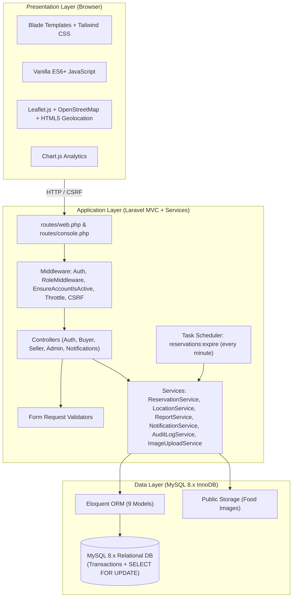

# RescueBite — Technical Documentation

## 1. System Architecture (Three-Tier Laravel MVC)

## 2. Core Technical Mechanisms

### 2.1 Location-Aware Discovery (Haversine Formula)
`LocationService` computes great-circle distance $d$ in kilometres between buyer coordinates $(\phi_1, \lambda_1)$ and store coordinates $(\phi_2, \lambda_2)$ with Earth radius $R = 6371\text{ km}$:
- Used in MySQL queries (`DiscoveryController::index`) with `LEAST(1.0, GREATEST(-1.0, ...))` clamping to prevent floating-point `ACOS` domain errors.
- Used in PHP (`DiscoveryController::map` and `show`) for interactive map popups and store distances.
- Buyers can grant one-time HTML5 Geolocation permission or click manually on the map; continuous background tracking is intentionally not implemented.

### 2.2 Reservation Concurrency Control & Idempotency
`ReservationService` enforces strict data integrity:
- **Row-Level Locking:** Wraps creation, cancellation, expiry, and collection inside `DB::transaction()` using `SELECT ... FOR UPDATE` (`lockForUpdate()`).
- **Expiry Formula:** $T_{\text{expiry}} = \min(T_{\text{reservation}} + 3\text{ hours}, T_{\text{collection\_deadline}})$.
- **Historical Price Preservation:** Copies `discounted_price` and `original_price` into `reservations` at booking time.
- **Conditional, Idempotent Stock Restoration:** Restores stock only if the listing is still `active`/`sold_out`, its deadline is in the future, and its store is active. A `UNIQUE` constraint on `stock_movements.idempotency_key` guarantees stock can never be restored twice.

### 2.3 Security Controls
- Bcrypt password hashing (`Hash::make`), session regeneration on login/logout, CSRF tokens on all state-changing forms, server-side Form Request validation, Eloquent parameterized queries (SQLi prevention), Blade `{{ }}` auto-escaping (XSS prevention), strict ownership checks (HTTP 403), MIME/size validation on uploads, route throttling (`throttle:5,1` on auth, `throttle:10,1` on reservations), and comprehensive audit logging.

### 2.4 Out-of-Scope Boundaries
POS integration, barcode scanning, online payment gateways, delivery logistics, partial collection, native mobile apps, automated food safety/inventory verification, and dynamic pricing are strictly excluded by design.
